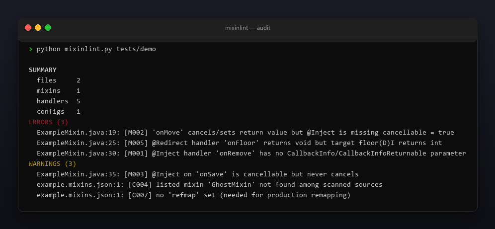
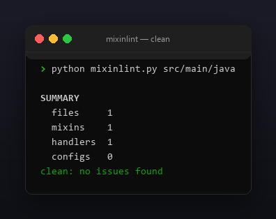

<p align="center"></p>

<p align="center">
  <a href="README.ru.md"></a>
  <a href="https://github.com/Celine1337/mixinlint/releases"></a>
  <a href="https://github.com/Celine1337/mixinlint/actions/workflows/ci.yml"></a>
  <a href="LICENSE"></a>
</p>


Static consistency linter for [SpongePowered Mixin](https://github.com/SpongePowered/Mixin)
sources. Mixin mistakes usually surface only at runtime as cryptic
`InvalidInjectionException` / `MixinApplyError` crashes. mixinlint reads your
`@Mixin` classes and `*.mixins.json` configs and flags the inconsistencies
*before* you launch the game:

- handler / `CallbackInfo` mismatches and missing `cancellable = true`;
- `@Redirect` handlers whose return type disagrees with the target descriptor;
- `@Overwrite` / `@Shadow` misuse;
- broken or incomplete mixin configs.

Single file, standard library only, Python 3.9+. No Minecraft installation, no
bytecode, no mappings — pure static analysis of your Java sources, so it runs
anywhere, including CI.


- Parses `@Mixin` class members (annotations, signatures, bodies) with a small
  comment- and string-aware scanner; generics, varargs and local-capture
  handler parameters are handled.
- Understands `@Inject`, `@Redirect`, `@Modify*`, `@Wrap*`, `@Overwrite`,
  `@Shadow`, `@Unique`.
- Validates `*.mixins.json`: required keys, `compatibilityLevel`, duplicate or
  missing mixin entries, absent `refmap`.
- `--json` machine-readable report; exit code `1` on errors so it works as a CI
  gate; `--strict` also fails on warnings.
- Colored ANSI output, `--no-color` and `NO_COLOR`.


| Code | Severity | Meaning |
|------|----------|---------|
| M001 | error | `@Inject` handler has no `CallbackInfo`/`CallbackInfoReturnable` parameter |
| M002 | error | handler cancels / sets return value but `cancellable = true` is missing |
| M003 | warning | `cancellable = true` but the handler never cancels |
| M004 | error | `setReturnValue` called on plain `CallbackInfo` |
| M005 | error | `@Redirect` return type disagrees with the target descriptor |
| M006 | error | `@Overwrite` method takes a `CallbackInfo` parameter |
| M007 | warning | injector handler is not `private` |
| M008 | warning | `@Shadow` method has a body (should be abstract/native) |
| M009 | error | `@Inject` has no `method` target |
| M010 | error | `@Inject` has no `at = @At(...)` |
| C001 | error | config missing `package` |
| C002 | error | config missing `compatibilityLevel` |
| C003 | warning | no mixin classes listed |
| C004 | warning | listed mixin not found among scanned sources |
| C005 | warning | duplicate mixin entry |
| C006 | error | invalid `compatibilityLevel` |
| C007 | warning | no `refmap` set |


```console
$ python mixinlint.py src/main/java
$ python mixinlint.py src/main/java --json
$ python mixinlint.py src/main/java --strict
```

```
SUMMARY
  files     2
  mixins    1
  handlers  5
  configs   1
ERRORS (3)
  ExampleMixin.java:19: [M002] 'onMove' cancels/sets return value but @Inject is missing cancellable = true
  ExampleMixin.java:25: [M005] @Redirect handler 'onFloor' returns void but target floor(D)I returns int
  ExampleMixin.java:30: [M001] @Inject handler 'onRemove' has no CallbackInfo/CallbackInfoReturnable parameter
WARNINGS (3)
  ExampleMixin.java:35: [M003] @Inject on 'onSave' is cancellable but never cancels
  example.mixins.json:1: [C004] listed mixin 'GhostMixin' not found among scanned sources
  example.mixins.json:1: [C007] no 'refmap' set (needed for production remapping)
```

Exit codes: `0` — clean (or warnings only), `1` — errors found (or warnings with
`--strict`), `2` — bad path / unreadable file.

Limits, on purpose: source-level only — it cannot resolve targets against
vanilla mappings, so it checks internal consistency, not whether a target
method actually exists. Java text blocks (`"""`) are not parsed.







```console
$ python -m unittest discover -s tests -v
```

35 tests cover every check, generics / local-capture parsing, comment and string
handling, config validation, JSON output and exit codes. The demo tree and all
images are regenerable:

```console
$ python tools/make_demo.py       # tests/demo with one of each issue
$ pip install pillow
$ python tools/make_shots.py      # docs/audit.png, docs/clean.png
$ python tools/make_style.py tools/style.json docs/style
```


[MIT](LICENSE) © Celine1337