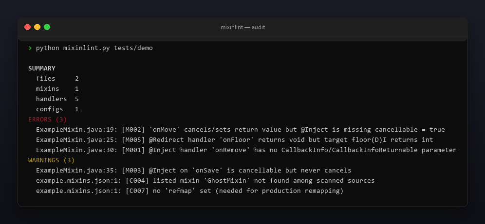
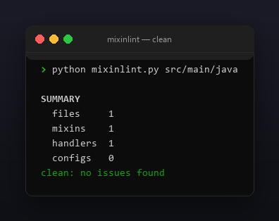

<p align="center"></p>

<p align="center">
  <a href="README.md"></a>
  <a href="https://github.com/Celine1337/mixinlint/releases"></a>
  <a href="https://github.com/Celine1337/mixinlint/actions/workflows/ci.yml"></a>
  <a href="LICENSE"></a>
</p>


Статический линтер консистентности для
[SpongePowered Mixin](https://github.com/SpongePowered/Mixin). Ошибки Mixin
обычно всплывают только в рантайме — криптичными
`InvalidInjectionException` / `MixinApplyError`. mixinlint читает ваши
`@Mixin`-классы и конфиги `*.mixins.json` и находит несоответствия *до* запуска
игры:

- несовпадения хендлеров и `CallbackInfo`, забытый `cancellable = true`;
- `@Redirect`-хендлеры, чей тип возврата не сходится с дескриптором цели;
- неправильное использование `@Overwrite` / `@Shadow`;
- сломанные или неполные mixin-конфиги.

Один файл, только стандартная библиотека, Python 3.9+. Ни Minecraft, ни
байткод, ни маппинги не нужны — чистый статический анализ Java-исходников,
поэтому работает где угодно, включая CI.


- Парсит члены `@Mixin`-класса (аннотации, сигнатуры, тела) небольшим
  сканером, учитывающим комментарии и строки; generics, varargs и параметры
  local-capture обрабатываются.
- Понимает `@Inject`, `@Redirect`, `@Modify*`, `@Wrap*`, `@Overwrite`,
  `@Shadow`, `@Unique`.
- Валидирует `*.mixins.json`: обязательные ключи, `compatibilityLevel`,
  дубликаты и отсутствующие записи, отсутствие `refmap`.
- `--json` — машинный отчёт; код возврата `1` при ошибках, так что это
  CI-гейт; `--strict` валит и на предупреждениях.
- Цветной ANSI-вывод, `--no-color` и `NO_COLOR`.


| Код | Уровень | Смысл |
|-----|---------|-------|
| M001 | ошибка | у `@Inject`-хендлера нет параметра `CallbackInfo`/`CallbackInfoReturnable` |
| M002 | ошибка | хендлер отменяет/ставит возврат, но нет `cancellable = true` |
| M003 | предупр. | `cancellable = true`, но хендлер не отменяет |
| M004 | ошибка | `setReturnValue` на обычном `CallbackInfo` |
| M005 | ошибка | тип возврата `@Redirect` не сходится с дескриптором цели |
| M006 | ошибка | `@Overwrite`-метод принимает `CallbackInfo` |
| M007 | предупр. | injector-хендлер не `private` |
| M008 | предупр. | у `@Shadow`-метода есть тело (должен быть abstract/native) |
| M009 | ошибка | у `@Inject` нет цели `method` |
| M010 | ошибка | у `@Inject` нет `at = @At(...)` |
| C001 | ошибка | в конфиге нет `package` |
| C002 | ошибка | в конфиге нет `compatibilityLevel` |
| C003 | предупр. | не перечислено ни одного mixin-класса |
| C004 | предупр. | перечисленный mixin не найден среди исходников |
| C005 | предупр. | дубликат записи mixin |
| C006 | ошибка | неверный `compatibilityLevel` |
| C007 | предупр. | не задан `refmap` |


```console
$ python mixinlint.py src/main/java
$ python mixinlint.py src/main/java --json
$ python mixinlint.py src/main/java --strict
```

```
SUMMARY
  files     2
  mixins    1
  handlers  5
  configs   1
ERRORS (3)
  ExampleMixin.java:19: [M002] 'onMove' cancels/sets return value but @Inject is missing cancellable = true
  ExampleMixin.java:25: [M005] @Redirect handler 'onFloor' returns void but target floor(D)I returns int
  ExampleMixin.java:30: [M001] @Inject handler 'onRemove' has no CallbackInfo/CallbackInfoReturnable parameter
WARNINGS (3)
  ExampleMixin.java:35: [M003] @Inject on 'onSave' is cancellable but never cancels
  example.mixins.json:1: [C004] listed mixin 'GhostMixin' not found among scanned sources
  example.mixins.json:1: [C007] no 'refmap' set (needed for production remapping)
```

Коды возврата: `0` — чисто (или только предупреждения), `1` — найдены ошибки
(или предупреждения с `--strict`), `2` — неверный путь / нечитаемый файл.

Ограничения сознательные: только уровень исходников — резолвить цели против
ванильных маппингов он не умеет, поэтому проверяет внутреннюю консистентность,
а не существование целевого метода. Java text blocks (`"""`) не парсятся.







```console
$ python -m unittest discover -s tests -v
```

35 тестов покрывают все проверки, парсинг generics / local-capture, обработку
комментариев и строк, валидацию конфигов, JSON-вывод и коды возврата. Демо-дерево
и все картинки перегенерируются:

```console
$ python tools/make_demo.py       # tests/demo с по одной каждой проблеме
$ pip install pillow
$ python tools/make_shots.py      # docs/audit.png, docs/clean.png
$ python tools/make_style.py tools/style.json docs/style
```


[MIT](LICENSE) © Celine1337